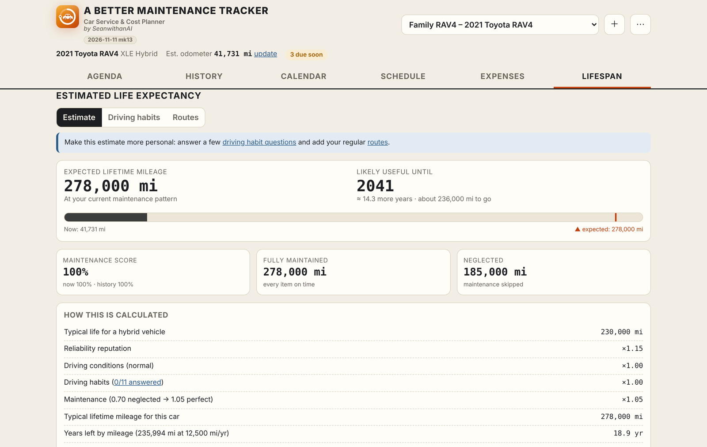

# A Better Maintenance Tracker

**Car Service & Cost Planner: what's due, what it costs, and how long your car will last**

**[▶ Open it online](https://seanwithanai.github.io/A-Better-Maintenance-Tracker/)** · nothing to install · your data stays on your device

*by SeanwithanAI*

---

## Overview

A Better Maintenance Tracker builds a maintenance schedule for each of your cars and tells you what's coming up. It shows what each job costs if you do it yourself versus at a shop, keeps a full service history, and estimates how many miles and years the car has left. It's all in one HTML file, with nothing to install and no sign-up.

## Features

- **Add a car in seconds.** Enter the VIN and the year, make, model, engine, transmission and drive type are decoded from the **NHTSA** database. Or fill them in by hand.
- **A schedule made for that car.** Intervals start from typical values for the powertrain (gas, diesel, hybrid or EV), transmission, drive type and driving conditions.
- **Details for every item.** Tap an item's name (or **Details**) to see what it is, why it matters, how it's done step by step, and what you'll need, with its interval, last service, next due date and cost. Add your own how-to notes (part numbers, sizes, tips) to any item. **Watch how** searches videos for your exact car.
- **Your factory schedule.** The owner's manual is the most accurate source, so the Schedule page tracks how much of your schedule has been checked against it (a progress bar and a *✓ Manual* or *Typical* tag on every item). Three ways to get there: **Check items one by one** (a guided walk through each item, with normal and severe intervals, or *Not in my manual* to turn it off); **Paste from manual** (paste the schedule text as written – one item per line or under headings like “Every 30,000 miles:”, with an optional *Severe* section – and see a preview before it updates your items); or **Find my manual**, a search for your exact year, make and model.
- **Agenda.** Everything due in the next 30 days, 3 months, 6 months or year, ranked Critical, Medium or Low. Shows the **DIY vs. shop** cost and estimated time for each job.
- **History and calendar.** Every service you've logged, plus a calendar of what's coming that you can export to your own calendar app.
- **Expenses.** Spending by category and by year, DIY savings, cost per mile, and a full service log you can filter by DIY or shop.
- **Built-in job timer** for timing DIY work, so time estimates learn from your own jobs.
- **Lifespan.** Expected lifetime mileage and the year the car is *likely useful until*, based on reliability, driving conditions, your habits, your regular routes and how well it's maintained. Shows which maintenance would add the most life.
- **Safety recalls.** Checks NHTSA for open recalls on your car.
- **Odometer tracking.** Update the odometer now and then, and yearly mileage is re-estimated so due dates stay accurate.
- **Multiple cars,** each with its own schedule and history.
- **Works on phones,** with a bottom tab bar and full-width dialogs on small screens.
- **Backup and restore,** with undo if you restore the wrong file.
- **Download app + data.** In **Back up & restore**, one click downloads a .zip with this version of the app, a backup of your data, and a short note on how to restore it. Open the HTML anywhere and restore the backup to pick up where you left off. In PageVault it's the exact file that's installed.

## Screenshots

| Expenses | Lifespan |
|---|---|
|  |  |

Screenshots use made-up example data.

## Getting started

1. Open `A-Better-Maintenance-Tracker-<date>-<mk>.html` in any modern browser, or open it from **PageVault**.
2. Click **+** to add a car. Decode the VIN or fill in the details, then enter the current odometer reading and your yearly miles.
3. Choose how the history should start: *on schedule*, *brand new* or *unknown*.
4. Check the **Agenda**, and use **Log maintenance** whenever you do a job.

Online lookups (VIN decoding, recalls, route maps) use free public services. Everything else works offline.

## Opening the file on your devices

**Easiest: the web link.** Open **[seanwithanai.github.io/A-Better-Maintenance-Tracker](https://seanwithanai.github.io/A-Better-Maintenance-Tracker/)** on any phone, tablet or computer. It's this same app, served by GitHub, and it always has the newest version. Nothing is sent anywhere: your data is saved in that browser on that device, just like the downloaded file. On iPhone or iPad, open it in Safari, tap **Share** (on iOS 26 and later, tap **•••** first), then **Add to Home Screen** to keep it like an app. On Android, use Chrome's **⋮ → Add to Home screen**.

Prefer to keep your own copy of the file? The steps below cover that.

The app is one self-contained `.html` file: no install, no account, nothing else to download. Download `A-Better-Maintenance-Tracker-<date>.html`: open it in the file list above, then use the **Download raw file** button (↓) at the top right of the file view.

**Desktop (Windows, macOS, Linux)**
1. Download the file and move it somewhere permanent, like Documents.
2. Double-click it. It opens in your default browser (Chrome, Edge, Firefox, Safari and Brave all work).
3. Bookmark it, and always open it the same way: same file, same place, same browser. Your data is saved in that browser for that file, so a copy in another folder or another browser starts empty.

**iPhone and iPad**
**Because of iOS, an HTML file saved on your iPhone or iPad can't be opened in Safari.** iOS doesn't offer Safari as a way to open it, and tapping the file in the Files app only shows a preview with the buttons turned off. Use one of these instead:
- **The web link (recommended).** See above.
- **PageVault.** Open the app's PageVault link in **Safari**, then tap **Share** (on iOS 26, tap **•••** first, then **Share**). Scroll down the list and tap **Add to Home Screen**. If it isn't there, tap **Edit Actions** at the bottom of the list and add it. It then opens like a regular app, and your data is saved on your server and syncs with your other devices.
- **Microsoft Edge (may work).** Save the file to the Files app, then try opening it with Edge (in Files, open the file, tap **Share** and choose **Edge**). Keep backups: data saved this way can be lost if Edge clears its storage.

**Android**
1. Download the file in Chrome.
2. Open it from Chrome: **⋮ → Downloads** and tap the file (or from the Files app, **Open with → Chrome**).
3. Open it from Chrome's Downloads each time. A home-screen shortcut to a downloaded file may stop working after Chrome restarts.
4. Turn on backups (the app reminds you every 7 days), or use **PageVault** and **⋮ → Add to Home screen** so your data lives on your server instead.

**Moving to another device:** download a backup in the app, open the same version on the new device, and restore the backup there. With PageVault there's nothing to move.

## Where your data is stored

| Opened from… | Saved to | Badge shown next to the car |
|---|---|---|
| **PageVault** | Your own server only, separately for each signed-in person. Nothing is kept in the browser. | *Saved to your server* |
| **A local file** | This browser only. Use **Back up & restore** to keep a copy. | *Saved on this device only* |

## Versioning

Only the newest release is kept here: `A-Better-Maintenance-Tracker-2026-11-16-mk2.html`. Each new release replaces it, and `docs/index.html` (what the web link opens) is updated to match. Your data isn't stored in the file, so moving to a new release keeps it (if you use the downloaded file, open the new one the same way as before, in the same browser, and download a backup first to be safe).

Releases are named with their date. The first release of a day is just the date; later releases that same day add `mk1`, `mk2`, `mk3`… (the count starts over each day). The version is also shown inside the app.

| Version | Notes |
|---|---|
| **2026-11-16 mk2** | Current release. |

A Better Maintenance Tracker · Car Service & Cost Planner · by SeanwithanAI

