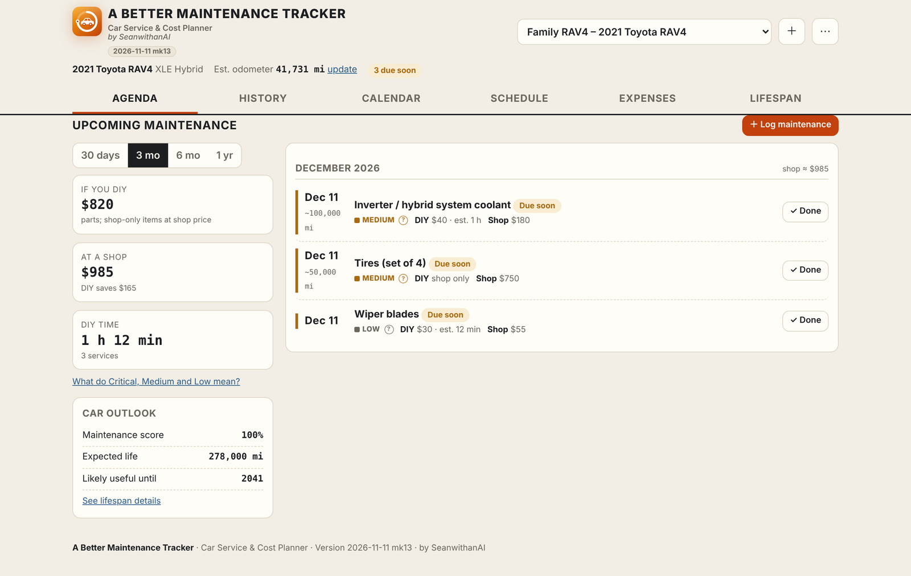
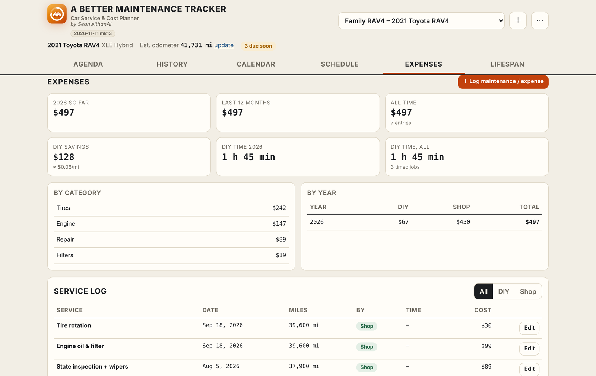
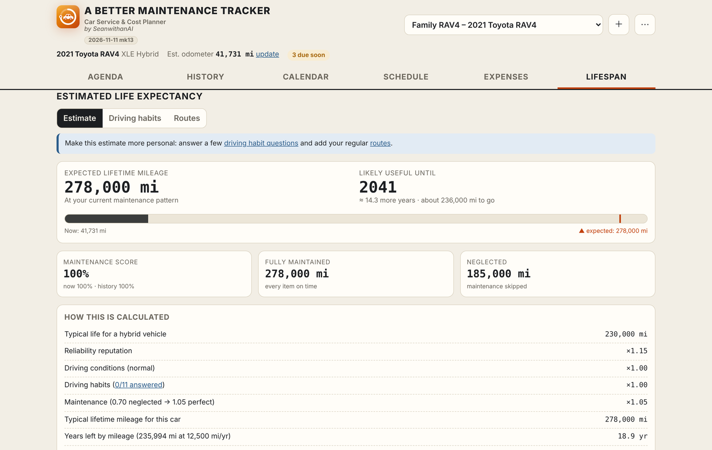

# A Better Maintenance Tracker

**Car Service & Cost Planner: what's due, what it costs, and how long your car will last**

*by SeanwithanAI*

---

## Overview

A Better Maintenance Tracker builds a maintenance schedule for each of your cars and tells you what's coming up. It shows what each job costs if you do it yourself versus at a shop, keeps a full service history, and estimates how many miles and years the car has left. It's all in one HTML file, with nothing to install and no sign-up.

## Features

- **Add a car in seconds.** Enter the VIN and the year, make, model, engine, transmission and drive type are decoded from the **NHTSA** database. Or fill them in by hand.
- **A schedule made for that car.** Intervals are tailored to the powertrain (gas, diesel, hybrid or EV), driving conditions and parts. You can edit any item, add your own, or import the manufacturer's official schedule.
- **Agenda.** Everything due in the next 30 days, 3 months, 6 months or year, ranked Critical, Medium or Low. Shows the **DIY vs. shop** cost and estimated time for each job.
- **History and calendar.** Every service you've logged, plus a calendar of what's coming that you can export to your own calendar app.
- **Expenses.** Spending by category and by year, DIY savings, cost per mile, and a full service log you can filter by DIY or shop.
- **Built-in job timer** for timing DIY work, so time estimates learn from your own jobs.
- **Lifespan.** Expected lifetime mileage and the year the car is *likely useful until*, based on reliability, driving conditions, your habits, your regular routes and how well it's maintained. Shows which maintenance would add the most life.
- **Safety recalls.** Checks NHTSA for open recalls on your car.
- **Odometer tracking.** Update the odometer now and then, and yearly mileage is re-estimated so due dates stay accurate.
- **Multiple cars,** each with its own schedule and history.
- **Works on phones,** with a bottom tab bar and full-width dialogs on small screens.
- **Backup and restore,** with undo if you restore the wrong file.

## Screenshots

| Expenses | Lifespan |
|---|---|
|  |  |

Screenshots use made-up example data.

## Getting started

1. Open `A-Better-Maintenance-Tracker-<date>-<mk>.html` in any modern browser, or open it from **PageVault**.
2. Click **+** to add a car. Decode the VIN or fill in the details, then enter the current odometer reading and your yearly miles.
3. Choose how the history should start: *on schedule*, *brand new* or *unknown*.
4. Check the **Agenda**, and use **Log maintenance** whenever you do a job.

Online lookups (VIN decoding, recalls, route maps) use free public services. Everything else works offline.

## Where your data is stored

| Opened from… | Saved to | Badge shown next to the car |
|---|---|---|
| **PageVault** | Your own server only, separately for each signed-in person. Nothing is kept in the browser. | *Saved to your server* |
| **A local file** | This browser only. Use **Back up & restore** to keep a copy. | *Saved on this device only* |

## Versioning

Every release is a new file named with the release date, plus `mkN` when there's more than one release that day, e.g. `A-Better-Maintenance-Tracker-2026-11-11-mk13.html`. The version also appears under the app's name and in the footer. Older files stay in the repo, so PageVault can roll back to any of them.

| Version | Notes |
|---|---|
| **2026-11-11 mk15** | Phone-friendly: nothing is cut off on small screens (320–412 px). The bottom tab bar fits all six tabs and stays fully on screen, *Done* buttons no longer get pushed off the edge by long *Overdue* labels, the car picker shows the nickname on phones, and times like "1 h 57 min" no longer break mid-value. |
| **2026-11-11 mk14** | New badge showing where data is saved: *Saved to your server* in PageVault (no "Backup due" reminder there), *Saved on this device only* elsewhere. |
| **2026-11-11 mk13** | Previous release |

---

A Better Maintenance Tracker · Car Service & Cost Planner · by SeanwithanAI · private repository

